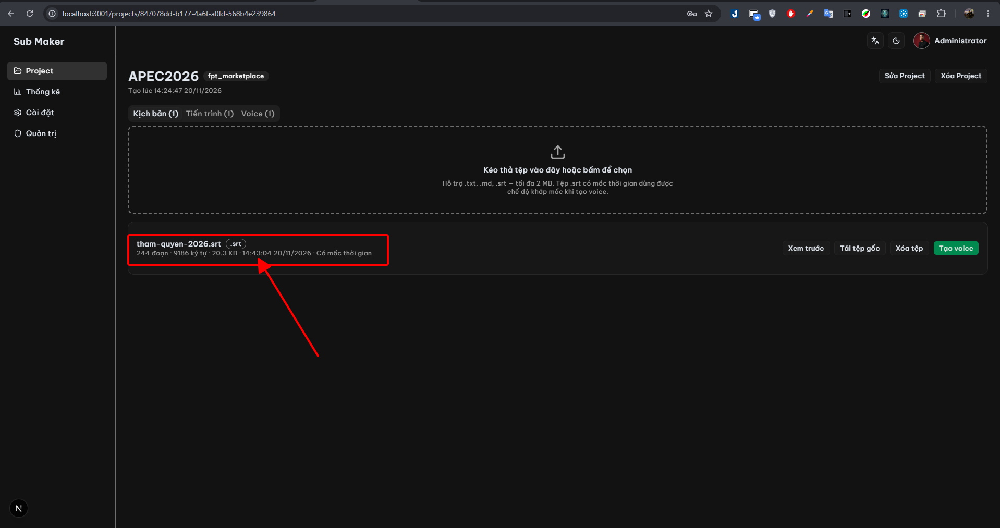
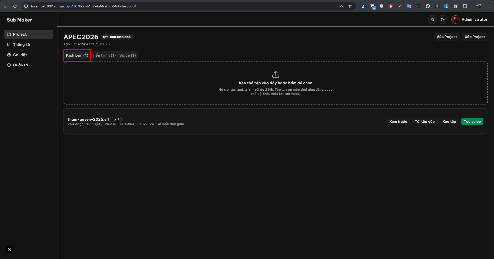
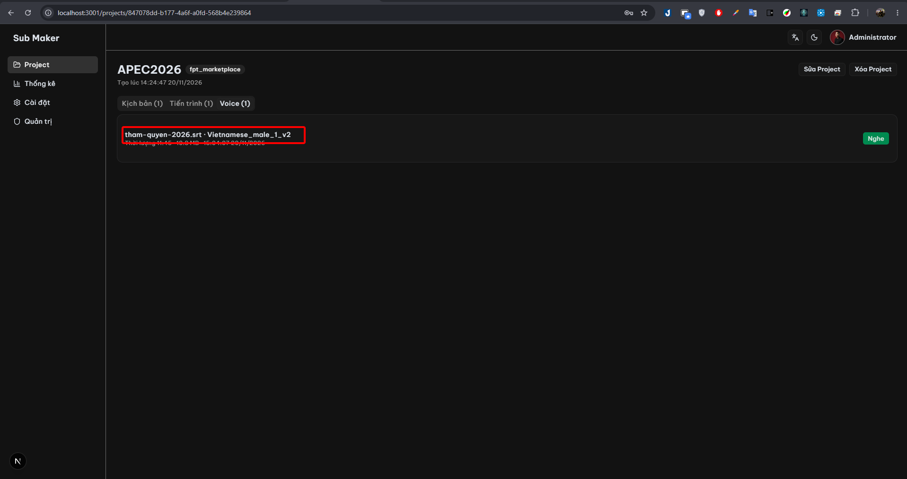
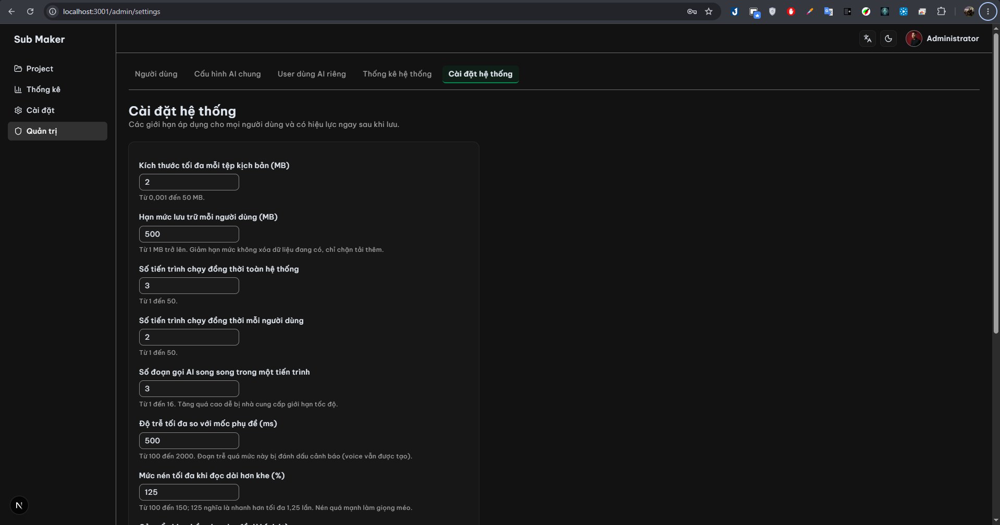

## Các vấn đề cần làm

1. Tìm tất cả select trong dự án hãy chuyển sang sử dụng popover select của Shacdn UI -> Nếu có rồi bỏ qua
2. Bấm vào tên foad để xem trước nội dung file
    
3. Tìm tất cả Tabs view trong dự án -> các TabsTrigger nào được select active thì đổi background của TabsTrigger đó thành `bg-primary` và text thành `text-primary-foreground`
    

4. Danh sách tiến trình: bấm vào dòng của mỗi tiến t-> hiện popover rình để xem chi các file tiết
    
    tương tự ở Voice cũng vậy
    
5. Trong cài đặt hệ thống -> Tôi mong muốn chia grid responsive cho các form settings -> các ô input full width
    

Xong 5 issue này hãy đẩy lên github -> git commit, git push