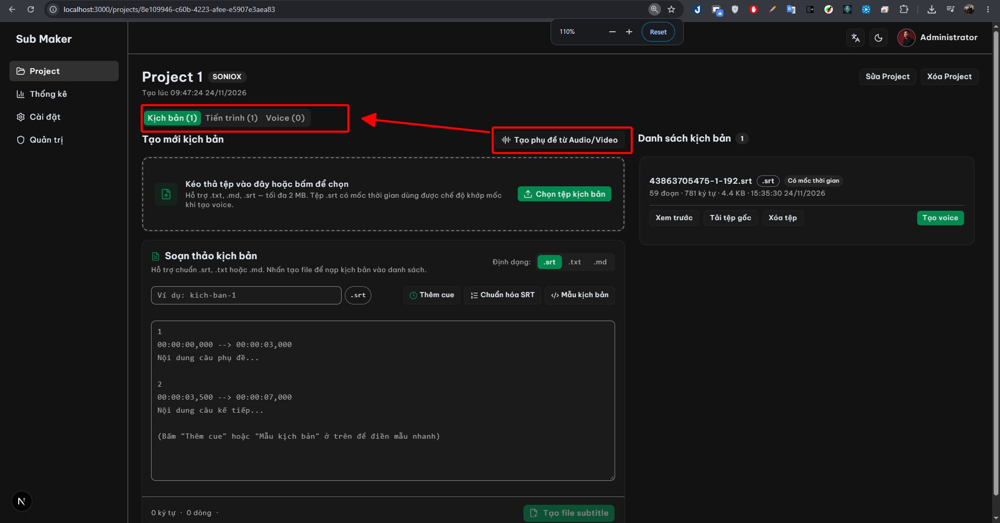
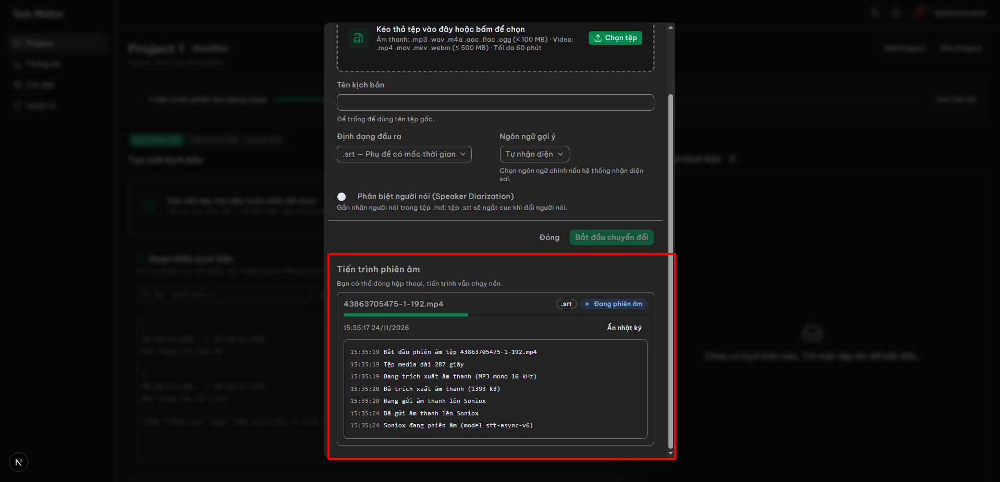

1. Tôi muốn có một Tabs view dành riêng cho việc xử lý với video, audio (như hình mô tả) -> Tôi muốn tách tính năng tạo file subtitle từ video, âm thanh ra đưa vào Tabs view dành riêng cho việc xử lý với video, audio. Tính năng tạo file subtitle sẽ nằm, khi tạo -> đưa UI tiến trình tạo file subtitle ra sang tabs view tiến trình -> sau khi hoàn thành -> hiển thị file subtitle trong Tabs view dành riêng cho việc xử lý với video, audio

Tabs view kịch bản sẽ tải lên hoặc import từ Tabs view dành riêng cho việc xử lý với video, audio để nạp file subttile vào

2. Tôi muốn sửa phần lựa chọn "Nhà cung cấp AI" trong create project và edit project -> Thay vào đó với mỗi tiến trình thực hiện sẽ chọn nhà cung cấp AI -> Khi tạo voice sẽ hiển thị dialog lựa chọn Nhà cung cấp AI
 
 **Chú ý:**
    - Lúc tạo voice thì hãy bỏ lựa chọn AI Provider Soniox ra khỏi lựa chọn
    - Lúc tạo file Subtile thì mặc định là Soniox rồi không cần phải tạo