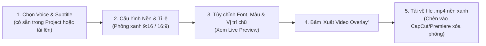

# Yêu cầu tính năng (REQ-005): Tạo Video Overlay Phụ đề Realtime (Chroma Key / Phông xanh)

> **Mục tiêu**: Xây dựng một tính năng độc lập trong Project cho phép tạo **video overlay hiển thị subtitle chạy đồng bộ thời gian thực với voice** trên nền đơn sắc (phông xanh lá / đen / trong suốt). Video này dùng để tải về, xóa phông (chroma key) và chèn đè lên video chính trong các phần mềm dựng phim (CapCut, Premiere, DaVinci Resolve, After Effects,...).

---

## 1. Đầu vào (Inputs)

Người dùng có thể chọn nguồn dữ liệu từ trong Project hoặc tải lên độc lập:
1. **File Âm thanh (Voice)**:
   - Chọn từ danh sách Voice đã tạo trong Project, hoặc:
   - Tải lên tệp âm thanh ngoài (`.mp3`, `.wav`, `.m4a`).
2. **File Phụ đề (Subtitle)**:
   - Chọn từ danh sách Kịch bản trong Project (tệp `.srt` có mốc thời gian), hoặc:
   - Tải lên tệp `.srt` từ máy tính.

---

## 2. Các nhóm tính năng chính

### 2.1. Cấu hình Khung hình & Nền video (Canvas & Background)
- **Tỉ lệ khung hình (Aspect Ratio)**:
  - `9:16` (1080x1920) — Dành cho TikTok, Reels, YouTube Shorts.
  - `16:9` (1920x1080) — Dành cho YouTube ngang, Facebook Video, màn hình ngang.
  - `1:1` (1080x1080) — Vuông.
- **Màu phông nền (Chroma Key Background)**:
  - **Phông xanh lá (Green Screen `#00FF00`)**: Chuẩn phổ biến nhất để key xóa phông.
  - **Phông xanh dương (Blue Screen `#0000FF`)**: Dành cho video có chủ thể màu xanh lá.
  - **Phông đen (`#000000`)**: Chế độ hòa trộn Screen/Lighten.
  - **Trong suốt (Alpha Channel)**: Xuất video định dạng `.mov` (ProRes 4444) hoặc `.webm` (VP9) không cần key.

---

### 2.2. Tùy chỉnh Kiểu chữ & Định dạng (Typography & Styling)
- **Phông chữ (Font)**: Hỗ trợ danh sách font tiếng Việt chuẩn (Be Vietnam Pro, Roboto, Montserrat, Inter, Arial,...).
- **Kích thước & Trọng lượng**: Thanh trượt Font Size, chọn độ đậm (Regular, Bold, ExtraBold).
- **Màu sắc & Hiệu ứng chữ**:
  - Màu chữ chính (Text Color).
  - Viền chữ (Stroke / Outline): Bật/Tắt, chọn màu viền và độ dày viền (giúp chữ nổi bật khi chèn video).
  - Đổ bóng (Drop Shadow): Bật/Tắt, màu bóng, độ mờ (blur).
  - Hộp nền phụ đề (Background Box): Tùy chọn nền hộp phía sau chữ, bo góc, độ trong suốt (opacity).
- **Vị trí & Canh lề (Position & Alignment)**:
  - Vị trí nhanh: Dưới cùng (Bottom - mặc định), Giữa màn hình (Center), Trên cùng (Top).
  - Tinh chỉnh toạ độ Y: Kéo thanh trượt căn chỉnh độ cao vị trí hiển thị chữ.
  - Canh lề: Canh giữa (Center), Canh trái (Left), Canh phải (Right).
  - Tự động xuống dòng khi câu dài (Max width).

---

### 2.3. Hiệu ứng hiển thị theo Voice (Animation & Highlight)
- **Chế độ đồng bộ âm thanh (Sync Mode)**:
  - **Theo từng câu (Cue / Sentence)**: Cả câu xuất hiện khi bắt đầu câu và biến mất khi kết thúc câu.
  - **Theo từng từ (Word-by-word)**: Từng từ xuất hiện hoặc nhảy ra theo đúng nhịp phát âm của voice (cần mốc timecode từng từ hoặc ước lượng tốc độ).
  - **Tô màu Karaoke (Karaoke Highlight)**: Toàn bộ câu hiển thị trước, chữ/từ được tô màu sáng dần lướt qua khi giọng đọc phát âm đến.

- **Danh mục Hiệu ứng Xuất hiện (Appearance Effects)**:
  1. **Nhóm Cơ bản & Tối giản (Minimal & Clean)**:
     - `None / Cut`: Xuất hiện dứt khoát theo mốc thời gian, không có chuyển động trễ (phù hợp tin tức, học thuật).
     - `Fade In / Out`: Mờ dần vào và mờ dần ra êm ái, thanh lịch (phù hợp vlog, phim tài liệu, tâm sự).
  2. **Nhóm Động lực & Trẻ trung (Dynamic & Viral — Chuẩn TikTok, Reels, Shorts)**:
     - `Pop-up (Zoom In)`: Chữ bung nhanh từ nhỏ (80%) lên kích thước chuẩn (100%), tạo độ nảy tập trung thị giác.
     - `Bounce / Elastic`: Bung to vượt cỡ 105% rồi co nhẹ về 100% có độ đàn hồi tự nhiên (hiệu ứng viral phổ biến nhất).
     - `Slide Up`: Chữ trượt mượt từ dưới lên vị trí hiển thị kèm hiệu ứng gia tốc (ease-out).
     - `Slide In (Trái / Phải)`: Chữ lướt nhanh từ cạnh trái hoặc cạnh phải vào tâm.
     - `Drop Down`: Chữ rơi nhẹ từ phía trên xuống có độ dằn quán tính.
  3. **Nhóm Theo nhịp nói & Nhấn mạnh từ (Voice Kinetic & Kinetic Typography)**:
     - `Word Pop`: Cả câu ẩn, từng từ lần lượt "bật nảy" ra màn hình theo từng nhịp ngắt nghỉ của voice.
     - `Word Active Scale & Color`: Cả câu hiện sẵn, riêng từ đang được đọc sẽ tự động **phóng to 115% - 120%** và **đổi màu highlight nổi bật** (vàng neon/đỏ/xanh), sau đó trở về bình thường khi sang từ tiếp theo.
     - `Karaoke Color Fill / Wipe`: Vệt màu quét qua từng âm tiết của chữ theo dạng thanh tiến trình âm thanh mượt mà.
     - `Typewriter (Máy đánh chữ)`: Chữ xuất hiện lần lượt từng ký tự như đang được gõ phím theo nhịp đọc.
  4. **Nhóm Điện ảnh & Sáng tạo (Cinematic & Creative FX)**:
     - `Motion Blur / Blur In`: Chữ xuất hiện từ trạng thái nhòe mờ quang học (blur) tụ lại thành sắc nét (rất sang trọng cho trailer/cinematic).
     - `Glitch / RGB Split`: Hiệu ứng giật tách màu đỏ - xanh (RGB glitch) trong tích tắc 0.1s khi đổi câu (dành cho video công nghệ, game, âm nhạc sôi động).
     - `Glow Pulse (Phát sáng Neon)`: Chữ bừng sáng viền quang học phát quang khi bắt đầu câu voice rồi dịu lại.
     - `Flip 3D`: Chữ xoay lật 3D quanh trục ngang (trục X) từ dưới lật lên khi xuất hiện.
     - `Shake / Tremble (Rung nhẹ)`: Chữ rung lắc nhẹ theo các câu nói có sắc thái cảm xúc mạnh (hét, giận dữ, bất ngờ).

- **Tùy chỉnh thông số hiệu ứng (Animation Parameters)**:
  - **Thời lượng hiệu ứng (Duration)**: Điều chỉnh từ `100ms` đến `600ms` (nhanh dứt khoát hoặc mượt mà).
  - **Độ nảy (Elasticity / Intensity)**: Tùy chỉnh mức độ nảy cho hiệu ứng Pop/Bounce (Nhẹ / Vừa / Mạnh).
  - **Màu sắc Highlight từ (Highlight Color)**: Chọn màu nổi bật cho từ đang nói (Vàng `#FFE600`, Xanh neon `#00FF66`, Đỏ cam `#FF4500`, Hồng phấn,...).
  - **Hiệu ứng biến mất (Exit Transition)**: Tùy chọn cách ẩn chữ (Tắt ngay, Mờ dần, hoặc Trượt xuống).

---

### 2.4. Trình xem trước thời gian thực (Live Preview Player)
- Trình phát video giả lập ngay trên màn hình cấu hình:
  - Phát âm thanh voice đồng bộ với chữ hiển thị trên nền phông xanh.
  - Mọi thay đổi về font, size, màu sắc, vị trí được cập nhật ngay lập tức (real-time preview) mà không cần chờ render.
  - Thanh tua thời gian (Seekbar) để kiểm tra các đoạn phụ đề khác nhau.

---

### 2.5. Xuất Video (Render & Export)
- **Engine xử lý**: Render video qua tiến trình backend (FFmpeg / Canvas render).
- **Định dạng file xuất**:
  - `.mp4` (H.264 / AAC) — Chuẩn nền xanh/đen tương thích 100% mọi máy và ứng dụng chỉnh sửa video.
  - `.mov` / `.webm` — Tùy chọn giữ kênh trong suốt (Alpha channel).
- **Tùy chọn tải về**: Nút tải file video overlay thành phẩm về máy.

---

## 3. Quy trình sử dụng mẫu (User Workflow)

---

## 4. Ghi chú kỹ thuật bổ sung
- Tính năng hoạt động độc lập (module/tab riêng trong Project, ví dụ tab **"Video Overlay"**).
- Tận dụng tiến trình nền (`pg-boss` / worker) khi render video dài để tránh nghẽn trình duyệt.
- Tự động khớp thời lượng video bằng chính xác thời lượng của file Voice.
