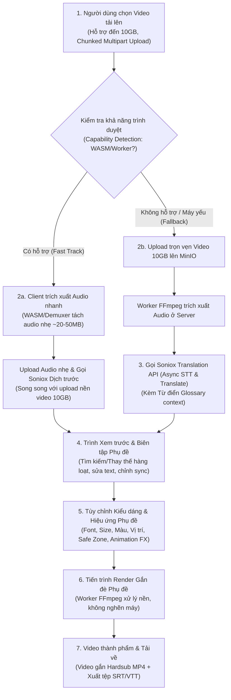

# Yêu cầu tính năng (REQ-006): Dịch Video Tự Động & Gắn Đè Phụ Đề (Video Translation & Overlay Subtitles)

> **Mục tiêu**: Xây dựng một tính năng hoàn chỉnh trong Project của **Sub Maker** cho phép người dùng tải lên **video bất kỳ (dung lượng lên đến 10GB)**, hệ thống sử dụng **Soniox Translation API** để nhận diện giọng nói (STT) và tự động dịch thuật sang ngôn ngữ đích (hỗ trợ dịch từ tất cả ngôn ngữ sang **Tiếng Việt**, hoặc từ Tiếng Việt sang **Tiếng Anh**). Kết quả đầu ra là **video hoàn chỉnh đã được gắn đè phụ đề (Hardsub/Overlay)** với đầy đủ tùy biến về kiểu chữ, vị trí, kích thước, hiệu ứng hoạt ảnh, cùng hệ thống kiểm soát thuật ngữ và công cụ biên tập phụ đề chuyên nghiệp.

---

## 1. Tổng quan & Luồng người dùng (User Workflow)



---

## 2. Đặc tả Chi tiết Tính năng (Functional Requirements)

### 2.1. Đầu vào & Cơ chế Xử lý Video Lớn (Lên đến 10GB)

1. **Định dạng Video đầu vào**:
   - Hỗ trợ các định dạng video thông dụng: `.mp4`, `.mov`, `.mkv`, `.webm`, `.avi`, `.flv`, `.m4v`.
   - Dung lượng tối đa: **10 GB / video**.
   - Hỗ trợ mọi tỷ lệ khung hình: `16:9` (ngang), `9:16` (dọc TikTok/Shorts/Reels), `1:1` (vuông), `4:5`, `21:9`.
2. **Cơ chế Tải lên Phân đoạn (Chunked / Multipart Direct-to-MinIO Upload)**:
   - File 10GB **không tải trực tiếp qua Next.js Server** để tránh tràn bộ nhớ đệm (RAM) và timeout HTTP.
   - Sử dụng cơ chế **S3 Multipart Upload qua Presigned URL** trực tiếp từ trình duyệt lên MinIO:
     - Chia nhỏ file video thành các part (mỗi part 10MB - 20MB).
     - Cho phép tạm dừng (Pause), tiếp tục (Resume) và tự động thử lại khi mạng chập chờn.
     - Hiển thị thanh tiến trình % upload, tốc độ upload (MB/s) và thời gian còn lại (ETA).
3. **Tối ưu hóa Băng thông & Tách Âm thanh ở Máy chủ (Server-side Audio Extraction)**:
   - Soniox chỉ cần dữ liệu âm thanh, không cần dữ liệu hình ảnh.
   - Worker backend dùng **FFmpeg** trích xuất luồng audio (định dạng AAC/MP3 16kHz - 48kHz, mono/stereo tối ưu cho STT).
   - Tệp audio sau khi tách chỉ chiếm khoảng **10MB - 80MB** (thay vì 10GB video), giúp việc tải lên Soniox API diễn ra tức thì, tiết kiệm 99% chi phí băng thông mạng.
4. **Cơ chế Tối ưu Trích xuất Audio Client-Side bằng WebAssembly / Web Worker ("Nếu có khả năng" - Progressive Enhancement)**:
   - **Đánh giá năng lực thiết bị & trình duyệt (Capability Detection)**:
     - Trước khi bắt đầu upload, hệ thống tự động kiểm tra xem trình duyệt và thiết bị của người dùng có hỗ trợ `WebAssembly`, `Web Worker` và bộ giải mã cần thiết (`WebCodecs` hoặc thư viện demuxer nhẹ như `mp4box.js` / WASM demuxer) hay không.
   - **Nhánh A: Trình duyệt & Thiết bị đủ khả năng (Fast Track - Client-side Extraction)**:
     - Trình duyệt tự đọc file cục bộ mà người dùng vừa chọn, tách lấy luồng audio stream (copy codec hoặc nén nhẹ thành AAC/MP3 ~20MB–50MB) trong vòng vài chục giây đến dưới 1 phút.
     - Gửi ngay file audio này lên máy chủ và kích hoạt Soniox STT & Translate ngay lập tức.
     - Trong khi Soniox đang dịch, tệp video 10GB vẫn tiếp tục được upload nền qua cơ chế S3 Multipart.
     - **Hiệu quả**: Tiết kiệm đến **70% - 80% tổng thời gian chờ đợi**. Khi video 10GB vừa upload xong thì phụ đề dịch đã sẵn sàng trên màn hình.
   - **Nhánh B: Thiết bị không đủ khả năng hoặc gặp lỗi (Graceful Fallback)**:
     - Nếu thiết bị có cấu hình yếu (RAM < 4GB hoặc di động cũ), trình duyệt không hỗ trợ WASM, hoặc quá trình trích xuất trên client gặp lỗi:
     - Hệ thống **tự động và êm dịu (silent fallback)** chuyển sang luồng chuẩn: Upload video 10GB lên MinIO trước, sau đó worker backend dùng FFmpeg tách audio như quy định tại Mục 2.1.3 mà không làm gián đoạn trải nghiệm người dùng.

---

### 2.2. Động cơ Dịch thuật Soniox (Soniox Translation Engine)

Tích hợp trực tiếp với API Speech-to-Text & Translation bất đồng bộ của **Soniox** (`stt-async-v6`):

1. **Các hướng dịch được hỗ trợ**:
   - **Tất cả ngôn ngữ $\rightarrow$ Tiếng Việt (`vi`)**: Tự động nhận diện ngôn ngữ nói trong video (Anh, Trung, Hàn, Nhật, Pháp, Tây Ban Nha, Đức, Nga,...) và dịch trực tiếp sang Tiếng Việt.
   - **Tiếng Việt (`vi`) $\rightarrow$ Tiếng Anh (`en`)**: Chuyển giọng nói tiếng Việt thành phụ đề tiếng Anh chuẩn ngữ pháp.
   - Tùy chọn mở rộng: Dễ dàng mở rộng sang các cặp ngôn ngữ khác theo danh mục hỗ trợ của Soniox.
2. **Cấu hình Payload gửi Soniox (kèm Từ điển Thuật ngữ)**:
   ```json
   {
     "model": "stt-async-v6",
     "file_id": "<soniox_audio_file_id>",
     "enable_language_identification": true,
     "enable_speaker_diarization": true,
     "translation": {
       "type": "one_way",
       "target_language": "vi"
     },
     "context": {
       "translation_terms": [
         { "source": "Sub Maker", "target": "Sub Maker" },
         { "source": "Machine Learning", "target": "Học máy" },
         { "source": "prompt engineering", "target": "kỹ nghệ câu lệnh" }
       ]
     }
   }
   ```
3. **Phân tích kết quả Tokens & Tạo Cue phụ đề**:
   - Lọc các token có `translation_status: "translation"` để lấy văn bản dịch chuẩn xác.
   - Lưu trữ song song cả **văn bản gốc** (`translation_status: "original"`) và **văn bản dịch** (`translation_status: "translation"`), gắn liền với mốc thời gian `start_ms` và `end_ms`.
   - **Thuật toán Ngắt câu thông minh (Smart Cues Segmentation)**:
     - Tự động gom các token thành các câu phụ đề ngắn vừa mắt (từ 5 - 12 từ / dòng).
     - Tự động ngắt dòng theo dấu câu tự nhiên (`.`, `,`, `?`, `!`) và nhịp ngắt nghỉ âm thanh (pause > 300ms) để phụ đề không bị quá dài hoặc tràn khỏi màn hình.
4. **Quản lý Từ điển Thuật ngữ & Tên riêng (Custom Translation Glossary / Terms)**:
   - **Mục tiêu**: Loại bỏ triệt để tình trạng AI dịch sai tên thương hiệu, tên riêng nhân vật, từ lóng, viết tắt hoặc thuật ngữ chuyên môn sâu (y tế, tài chính, công nghệ).
   - **Giao diện cấu hình**:
     - Cho phép người dùng nhập các cặp từ: `Từ gốc` $\rightarrow$ `Từ dịch mong muốn` (hoặc đánh dấu "Giữ nguyên không dịch").
     - Hỗ trợ nhập danh sách nhanh dạng bảng hoặc dán hàng loạt (mỗi dòng một cặp từ cách nhau bởi dấu `->` hoặc `,`).
     - Tự động lưu trữ bộ từ điển này theo **Project** để tái sử dụng xuyên suốt cho các video cùng chủ đề.
   - **Tác động kỹ thuật**: Ánh xạ trực tiếp vào tham số `context.translation_terms` của Soniox API trước khi kích hoạt tiến trình dịch.

---

### 2.3. Trình Xem trước & Biên tập Phụ đề (Live Preview & Subtitle Editor)

Trước khi tiến hành render một video nặng 10GB, người dùng cần có quyền kiểm tra và tinh chỉnh:

1. **Trình phát Video Đồng bộ (Synchronized Video Player)**:
   - Trình phát video HTML5 tích hợp ngay trong giao diện web.
   - Phụ đề hiển thị nổi (overlay giả lập) trực tiếp trên video theo thời gian thực (real-time rendering).
   - Khi video chạy, danh sách phụ đề tự động cuộn (auto-scroll) và tô sáng câu đang phát.
   - Bấm vào bất kỳ câu phụ đề nào, video sẽ tự tua ngay đến thời điểm đó.
2. **Bảng chỉnh sửa Kịch bản Song ngữ (Bilingual Subtitle Editor)**:
   - Hiển thị 2 cột song song: **Câu gốc (Transcribed)** và **Câu dịch (Translated)**.
   - Cho phép người dùng bấm vào sửa trực tiếp câu dịch (sửa lỗi chính tả, thay đổi từ ngữ theo văn cảnh).
   - Cho phép chỉnh sửa mốc thời gian: Kéo timeline, tăng/giảm mốc bắt đầu/kết thúc (Nudge time offset ±100ms, ±500ms).
   - Nút **Thêm dòng phụ đề mới** hoặc **Gộp 2 câu / Tách câu làm đôi**.
3. **Thanh công cụ Tìm kiếm & Thay thế Hàng loạt (Global Find & Replace)**:
   - **Mục tiêu**: Giúp người dùng chỉnh sửa nhanh hàng loạt lỗi từ vựng xuất hiện lặp đi lặp lại trong toàn bộ video mà không phải dò từng câu thủ công.
   - **Khả năng chi tiết**:
     - Ô **Tìm kiếm (Find)**: Nhập từ hoặc cụm từ cần tìm kiếm, hiển thị ngay số lượng kết quả khớp (ví dụ: "Tìm thấy 14 kết quả") và làm nổi bật (highlight vàng) các vị trí xuất hiện trong kịch bản.
     - Ô **Thay thế (Replace)**: Nhập từ/cụm từ thay thế mới.
     - Nút **"Thay thế câu này" (Replace)**: Chỉ thay thế ở câu đang chọn và nhảy đến câu tiếp theo.
     - Nút **"Thay thế tất cả" (Replace All)**: Thay thế toàn bộ 100% các vị trí khớp chỉ trong 1 cú nhấp chuột.
     - Các tùy chọn nâng cao:
       - *Phân biệt chữ hoa/thường (Case sensitive)*.
       - *Khớp chính xác cả từ (Match whole word)* để tránh thay thế nhầm các từ có chứa chuỗi ký tự đó.
       - Cho phép áp dụng tìm/thay thế riêng cho cột **Câu dịch** hoặc cột **Câu gốc**.

---

### 2.4. Tùy chỉnh Kiểu dáng, Vị trí & Hiệu ứng Phụ đề (Subtitle Styling & Animation)

Kế thừa và tối ưu hóa từ bộ engine tạo phụ đề (tương thích hoàn toàn với chuẩn REQ-005):

1. **Chế độ hiển thị Phụ đề (Display Mode)**:
   - **Chỉ hiển thị bản dịch (Translated Only - Mặc định)**: Hiển thị duy nhất dòng chữ dịch sang tiếng Việt hoặc tiếng Anh.
   - **Hiển thị Song ngữ (Bilingual Subtitles)**:
     - Dòng 1: Ngôn ngữ gốc (chữ nhỏ hơn, màu phụ hoặc làm mờ).
     - Dòng 2: Bản dịch (chữ to nổi bật, màu chính).
   - **Chỉ hiển thị bản gốc (Original Only)**: Dùng khi người dùng chỉ muốn làm phụ đề cùng ngôn ngữ với video.
2. **Tùy biến Kiểu chữ (Typography)**:
   - **Phông chữ (Fonts)**: Tuyển chọn các font chữ Việt hóa không lỗi dấu: `Be Vietnam Pro`, `Roboto`, `Montserrat`, `Inter`, `Arial`, `Oswald`, `Open Sans`.
   - **Kích thước chữ (Font Size)**: Thanh trượt từ 16px đến 96px (tương thích theo độ phân giải video).
   - **Độ đậm (Font Weight)**: `Regular (400)`, `SemiBold (600)`, `Bold (700)`, `ExtraBold (800)`.
   - **Màu chữ chính (Primary Color)**: Bảng màu nhanh (Trắng, Vàng chanh, Xanh neon, Hồng pastel...) hoặc mã HEX tùy chọn.
   - **Viền chữ (Text Outline / Stroke)**: Bật/tắt, chọn màu viền (thường là đen để tương phản tốt trên mọi khung cảnh), độ dày viền (1px - 10px).
   - **Đổ bóng (Drop Shadow)**: Bật/tắt, điều chỉnh độ mờ (blur), khoảng cách bóng và độ đậm.
   - **Hộp nền phụ đề (Background Box / Banner)**: Đặt một hộp màu nền phía sau chữ với độ trong suốt (opacity 0% - 100%) và bo góc (border radius) giúp chữ luôn rõ nét dù video nền sáng hay tối.
3. **Vị trí & Canh lề (Position & Layout)**:
   - **Vị trí nhanh**: Dưới cùng (Bottom - 85%), Giữa màn hình (Center - 50%), Trên cùng (Top - 15%).
   - **Tinh chỉnh tọa độ Y**: Thanh trượt từ 0% đến 100% chiều cao video.
   - **Canh lề**: Căn giữa (Center), Căn trái (Left), Căn phải (Right).
   - **Chiều rộng tối đa (Max Width)**: Giới hạn chiều rộng khối phụ đề (ví dụ 80% chiều rộng video) để tự động xuống dòng thẩm mỹ.
4. **Vùng an toàn Mạng xã hội (Social Media Safe Zone Guide)**:
   - Nút bật lưới an toàn mô phỏng giao diện người dùng (UI Overlay) của:
     - **TikTok**: Vùng chứa nút like/share bên phải, caption & âm thanh bên dưới.
     - **YouTube Shorts**: Vùng nút tương tác bên phải và thanh tiến trình dưới.
     - **Instagram Reels**: Vùng mô tả tài khoản và thanh điều hướng.
   - Giúp người dùng đặt phụ đề không bao giờ bị các nút bấm của mạng xã hội che khuất.
5. **Hiệu ứng Hoạt ảnh Phụ đề (Animation Effects)**:
   - **Hiệu ứng Xuất hiện**:
     - *Cơ bản*: Cut / Instant (hiện tức thì), Fade In (mờ dần vào).
     - *Viral Trends (TikTok/Reels)*: **Pop-up** (nảy từ 80% lên 100%), **Bounce / Elastic** (co giãn đàn hồi), **Slide Up** (trượt từ dưới lên).
     - *Nhịp đọc & Chữ chạy*: **Word-by-word Pop** (từng từ bung ra theo nhịp nói), **Typewriter** (đánh chữ từng ký tự).
     - *Karaoke Highlight*: Chữ hiện trước, từ đang phát âm được đổi màu rực rỡ và phóng to nhẹ 115%.
     - *Nghệ thuật*: **Motion Blur**, **Glow Pulse (sáng Neon)**.
   - **Thời lượng hoạt ảnh**: Tùy chỉnh tốc độ nảy/trượt từ `100ms` đến `500ms`.

---

### 2.5. Động cơ Xuất Video & Gắn đè Phụ đề (Video Rendering & Export)

1. **Tiến trình Xử lý Nền (Background Worker Engine)**:
   - Xử lý hoàn toàn ở backend worker thông qua hàng đợi `pg-boss`.
   - Người dùng có thể đóng trình duyệt, tắt máy, tiến trình vẫn tiếp tục xử lý trên máy chủ.
   - Báo cáo tiến độ thời gian thực (0% - 100%) qua kênh **Server-Sent Events (SSE)** kèm nhật ký chi tiết:
     - `0% - 10%`: Tách âm thanh & chuẩn bị dữ liệu (hoặc nhận audio đã tách sẵn từ client).
     - `10% - 40%`: Gọi Soniox STT & Nhận kết quả dịch (đã áp dụng Glossary).
     - `40% - 50%`: Tạo timeline và kịch bản phụ đề chuẩn hóa.
     - `50% - 95%`: Render gắn đè phụ đề vào video bằng FFmpeg.
     - `95% - 100%`: Hoàn tất, đóng gói file thành phẩm và lưu vào MinIO.
2. **Chế độ Render FFmpeg**:
   - Dùng bộ lọc `subtitles` hoặc `ass` filter của FFmpeg, hoặc Canvas Pipe kết hợp phần cứng GPU/CPU để vẽ hoạt ảnh mượt mà ở tốc độ khung hình gốc của video (24fps, 30fps, 60fps).
   - Bảo toàn chất lượng hình ảnh và âm thanh gốc (sử dụng codec `h264`, `aac`, giữ nguyên bitrate hoặc áp dụng CRF 18-22 cân bằng dung lượng và độ nét).
3. **Đầu ra & Tùy chọn Tải về (Export Options)**:
   - **Video hoàn chỉnh đã gắn phụ đề (.mp4)**: Video có phụ đề dán cứng (Hardsub), sẵn sàng chia sẻ ngay lên mạng xã hội hoặc phát trên mọi thiết bị.
   - **Tệp phụ đề rời (.srt / .vtt)**: Cho phép tải riêng file phụ đề dịch để sử dụng làm Softsub trên YouTube/Facebook.
   - **Video Overlay Phông xanh / Nền trong suốt (.mp4 / .mov)**: Cho phép xuất riêng dải video phụ đề trên nền xanh để người dựng phim tự chèn vào Premiere / CapCut.

---

## 3. Thiết kế Kỹ thuật Dự kiến (Technical Architecture)

### 3.1. Cấu trúc Bảng Cơ sở Dữ liệu (Drizzle ORM Schema Đề xuất)

```typescript
// src/lib/db/schema/video-translate-jobs.ts

export const videoTranslateJobStatus = pgEnum('video_translate_job_status', [
  'queued',          // Đang xếp hàng
  'uploading',       // Đang upload video (Multipart S3)
  'extracting_audio',// Đang tách audio từ video (Client hoặc Server)
  'translating',     // Soniox đang STT & Dịch
  'review_ready',    // Đã có phụ đề dịch, chờ user duyệt/chỉnh sửa
  'rendering',       // Đang render gắn hardsub vào video
  'completed',       // Hoàn tất thành phẩm
  'failed',          // Có lỗi
  'interrupted'      // Bị gián đoạn
]);

export type TranslationTerm = {
  source: string;
  target: string;
};

export const videoTranslateJobs = pgTable('video_translate_jobs', {
  id: uuid('id').primaryKey().defaultRandom(),
  projectId: uuid('project_id').notNull().references(() => projects.id, { onDelete: 'cascade' }),
  ownerId: uuid('owner_id').notNull().references(() => users.id, { onDelete: 'cascade' }),
  
  // Thông tin video gốc
  originalFileName: text('original_file_name').notNull(),
  fileSizeBytes: bigint('file_size_bytes', { mode: 'number' }).notNull(),
  videoDurationMs: integer('video_duration_ms'),
  resolutionWidth: integer('resolution_width'),
  resolutionHeight: integer('resolution_height'),
  sourceVideoStorageKey: text('source_video_storage_key').notNull(),
  extractedAudioStorageKey: text('extracted_audio_storage_key'),
  extractedOnClient: boolean('extracted_on_client').notNull().default(false),
  
  // Cấu hình dịch & Từ điển thuật ngữ (Glossary)
  sourceLanguage: text('source_language').notNull().default('auto'),
  targetLanguage: text('target_language').notNull().default('vi'), // 'vi' hoặc 'en'
  translationTerms: jsonb('translation_terms').$type<TranslationTerm[]>().notNull().default([]),
  sonioxFileId: text('soniox_file_id'),
  sonioxTranscriptionId: text('soniox_transcription_id'),
  
  // Trạng thái & Tiến độ
  status: videoTranslateJobStatus('status').notNull().default('queued'),
  progressPercent: integer('progress_percent').notNull().default(0),
  stageMessage: text('stage_message'),
  errorCode: text('error_code'),
  errorMessage: text('error_message'),
  
  // Cấu hình kiểu dáng phụ đề (Font, Size, Màu, Hiệu ứng, Vị trí)
  subtitleStyling: jsonb('subtitle_styling').notNull(),
  
  // Kết quả sau khi render
  outputVideoStorageKey: text('output_video_storage_key'),
  outputSubtitleStorageKey: text('output_subtitle_storage_key'),
  
  createdAt: timestamp('created_at', { withTimezone: true }).notNull().defaultNow(),
  updatedAt: timestamp('updated_at', { withTimezone: true }).notNull().defaultNow(),
  finishedAt: timestamp('finished_at', { withTimezone: true }),
});
```

### 3.2. Quản lý Bộ nhớ & Tự động Thu hồi Tài nguyên (Storage Cleanup)

- Video 10GB chiếm dụng dung lượng rất lớn trên hệ thống lưu trữ MinIO.
- **Quy tắc dọn dẹp (Lifecycle Rule)**:
  - File video gốc tạm thời sẽ được lên lịch xóa tự động sau **48 giờ** kể từ khi hoàn tất render hoặc khi người dùng chủ động xóa job.
  - Video thành phẩm được giữ theo hạn mức lưu trữ (Quota) của từng tài khoản người dùng.
  - Tệp phụ đề nhẹ (`.srt`) được lưu trữ vĩnh viễn trong Project.

---

## 4. Tiêu chí Chấp thuận (Acceptance Criteria / Definition of Done)

| STT | Tiêu chí Kiểm tra | Kết quả Mong đợi |
| :--- | :--- | :--- |
| **AC-01** | Tải lên video lớn (lên đến 10GB) | Tải mượt mà qua multipart upload lên MinIO, có thanh tiến trình, pause/resume không bị lỗi timeout. |
| **AC-02** | Trích xuất audio Server & Client (WASM) | Tự động phát hiện khả năng trình duyệt: Nếu hỗ trợ WASM/Worker, trích xuất audio trên client và gửi dịch song song với upload video; nếu không hỗ trợ hoặc máy yếu, tự động fallback an toàn sang FFmpeg server-side. |
| **AC-03** | Tích hợp Soniox Translation | Gọi Soniox STT & Translate chính xác cho 2 chiều: Các thứ tiếng $\rightarrow$ Tiếng Việt, và Tiếng Việt $\rightarrow$ Tiếng Anh. |
| **AC-04** | Từ điển Thuật ngữ (Glossary) | Cho phép nhập danh sách cặp từ (`source` $\rightarrow$ `target`) gửi vào `context.translation_terms` của Soniox; kết quả dịch đúng chuẩn theo glossary đã định nghĩa. |
| **AC-05** | Tìm kiếm & Thay thế Hàng loạt | Tìm kiếm từ khóa và "Thay thế tất cả" (Replace All) hoạt động chuẩn xác trên toàn bộ kịch bản phụ đề, hỗ trợ phân biệt hoa/thường và khớp nguyên từ. |
| **AC-06** | Trình Preview & Chỉnh sửa phụ đề | Video chạy đồng bộ với phụ đề; sửa chữ, chỉnh thời gian mốc câu hoạt động tức thì trên UI trước khi xuất. |
| **AC-07** | Tùy biến kiểu dáng & Hiệu ứng | Hỗ trợ đầy đủ font tiếng Việt không lỗi, đổi màu, viền, vị trí (Top/Center/Bottom), các hiệu ứng nảy/chữ chạy mượt mà. |
| **AC-08** | Xuất Video Hardsub thành phẩm | Render video MP4 với phụ đề in nổi sắc nét, hình ảnh và âm thanh gốc không bị giật, lệch tiếng (desync) hay vỡ hạt. |
| **AC-09** | Bền bỉ & Phục hồi khi có sự cố | Tiến trình chạy ngầm qua `pg-boss`, nếu worker khởi động lại hoặc mạng ngắt quãng thì tự động phục hồi đúng trạng thái. |
