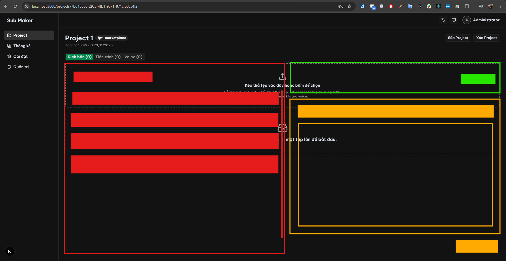

1. Tôi muốn ở màn hình upload file kịch bản của dự án thay đổi chút layout giao diện
theo hình mô tả dưới đây:

- 1. Khung màu đỏ sẽ hiển thị danh sách các file kịch bản đã tải lên hoặc đã tạo.
- 2. Khung màu xanh lá cây sẽ hiển thị thông tin, nút button upload file kịch bản lên -> sau khi upload thành công sẽ hiển thị vào danh sách ở bên khung màu đỏ
- 3. Khung màu vàng sẽ là phần editor dành cho kịch bản -> hãy các tính năng cơ bản của trình soạn thảo để làm file kịch bản đúng chuẩn file .srt, có thể đổi sang dạng .txt hoặc .md -> sau khi viết kịch bản cho subtitle xong thì bấm nút tạo file subtitle -> sau đó nạp vào danh sách hiển thị ở khung màu đỏ

**Chú ý:** Tôi chỉ mô tả các khung màu để phân biệt layout không đại diện cho thiết kế phải làm, hãy làm đúng với quy ước thiết kế của theme