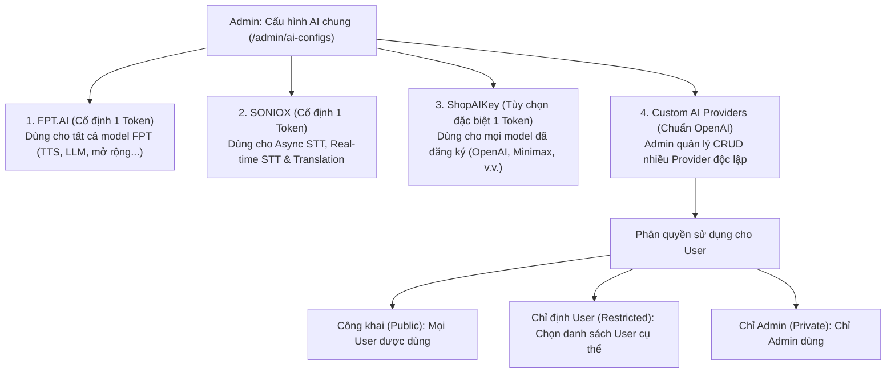
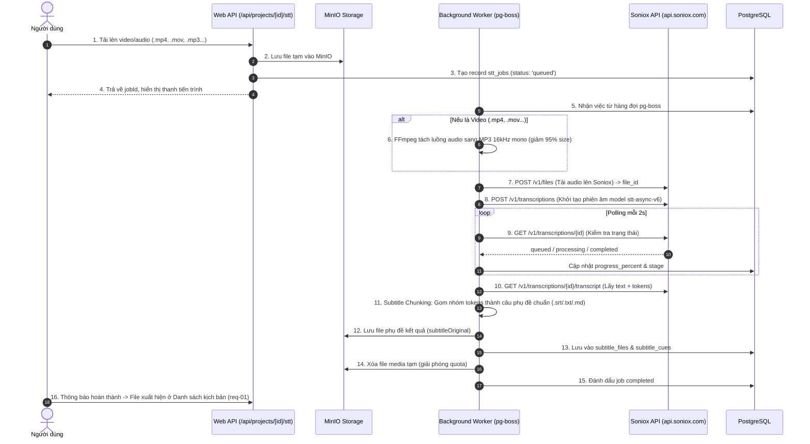

# Giải pháp kỹ thuật: STT Soniox & Tái cấu trúc Cấu hình AI Provider Quản trị

> **Tài liệu phân tích & đề xuất kiến trúc kỹ thuật (Phiên bản cập nhật)**  
> **Mục tiêu**: 
> 1. Phát triển tính năng STT (Speech-to-Text) tạo file phụ đề (.srt, .txt, .md) từ Audio/Video thông qua Soniox API.
> 2. Tái cấu trúc toàn diện hệ thống **Cấu hình AI chung của Admin** (`/admin/ai-configs`): FPT.AI (1 token dùng mọi model), Soniox (1 token cho Async, Realtime STT & Translation sau này), ShopAIKey (1 token dùng mọi model đã đăng ký), và Hệ thống Quản lý CRUD các Custom AI Provider chuẩn OpenAI kèm phân quyền linh hoạt cho User.

---

## 1. Tổng quan Kiến trúc Cấu hình AI trong Cài đặt Admin

Hệ thống cấu hình AI chung của Admin (`/admin/ai-configs`) được tái cấu trúc thành **4 nhóm nhà cung cấp rõ ràng, mở rộng và bảo mật**:



### 1.1. Bốn nhóm AI Provider chi tiết

#### Nhóm 1: FPT.AI (Mặc định cốt lõi)
- **Quy tắc 1 Token duy nhất**: Quản trị viên chỉ cần nhập **1 API Key** duy nhất của FPT.AI. Khóa này được sử dụng chung cho:
  - Các model TTS hiện tại: `FPT.AI-VITs`, `FPT.TTS-pro`, `FPT.TTS-ultra` (Ban Mai, Thu Minh, Lê Minh, Quang Anh,...).
  - Sẵn sàng cho các model AI mở rộng khác của FPT trong tương lai (LLM, Chat, OCR,...).
- **Thiết lập**: Base URL mặc định `https://mkp-api.fptcloud.com/v1`, lựa chọn model mặc định, kiểm tra kết nối, bật/tắt.

#### Nhóm 2: SONIOX (Mặc định cho STT & Mở rộng)
- **Quy tắc 1 Token duy nhất**: Quản trị viên chỉ cần nhập **1 API Key** duy nhất của Soniox. Khóa này mở quyền sử dụng cho:
  - **Async STT (Khuyến nghị cho task này)**: Mô hình `stt-async-v6` (hoặc `stt-async-v5` cũ) để phiên âm tệp audio/video tạo file phụ đề `.srt`, `.txt`, `.md`.
  - **Real-time STT**: Mô hình `stt-rt-v6` (chuẩn bị sẵn cho tính năng thu âm trực tiếp / voice agent sau này).
  - **Translation**: Chuẩn bị sẵn token và kiến trúc để mở rộng tính năng dịch thuật phụ đề đa ngữ trong tương lai.
- **Thiết lập**: Base URL mặc định `https://api.soniox.com`, chọn model STT mặc định, nút Test Connection gọi `GET /v1/models` để kiểm tra khóa và đồng bộ model.

#### Nhóm 3: ShopAIKey (Tùy chọn đặc biệt)
- **Quy tắc 1 Token duy nhất**: Quản trị viên chỉ cần nhập **1 API Key** duy nhất của ShopAIKey.
- Khóa này dùng chung cho tất cả các dịch vụ/model đã được cấp quyền trên ShopAIKey (OpenAI TTS, Minimax Voice, và các model mở rộng khác ngoài TTS sau này).
- **Thiết lập**: Base URL mặc định `https://api.shopaikey.com`, danh sách model đăng ký, bật/tắt.

#### Nhóm 4: Custom AI Providers chuẩn OpenAI (CRUD & Phân quyền linh hoạt)
- **Dành cho Admin**:
  - Quản lý danh sách **CRUDS** (Tạo mới, Xem danh sách, Cập nhật, Xóa) nhiều AI Provider từ bên thứ ba (ví dụ: DeepSeek, Together AI, Groq, OpenAI chính thức, Local vLLM/Ollama,...).
  - Mỗi Provider tuân thủ chuẩn OpenAI REST API (`/chat/completions`, `/audio/speech`, `/models`...).
  - **Cơ chế phân quyền linh hoạt**:
    - **Công khai (Public)**: Bật công khai cho toàn bộ User trong hệ thống sử dụng.
    - **Chỉ định User (Restricted)**: Chọn một hoặc nhiều User cụ thể từ danh sách hệ thống được phép dùng provider này.
    - **Riêng tư (Private)**: Chỉ dành riêng cho Administrator.
- **Dành cho User** (được cấp quyền dùng AI riêng):
  - User có thể tự thêm cấu hình AI Provider chuẩn OpenAI cá nhân của họ tại `/settings/ai` để sử dụng độc lập (chi phí cá nhân tự chịu).

---

## 2. Thiết kế Giao diện Quản trị "Cấu hình AI chung" (`/admin/ai-configs`)

Giao diện trang Quản trị AI chung được chia thành 4 Tab trực quan:

```
┌────────────────────────────────────────────────────────────────────────────────────────┐
│  Cấu hình AI chung                                                                     │
│  Quản lý khóa API, danh mục mô hình và phân quyền nhà cung cấp AI trong hệ thống        │
├────────────────────────────────────────────────────────────────────────────────────────┤
│  [ FPT.AI ]   [ SONIOX STT ]   [ ShopAIKey ]   [ Nhà cung cấp OpenAI tùy chỉnh (3) ]   │
└────────────────────────────────────────────────────────────────────────────────────────┘
```

### 2.1. Chi tiết Tab "FPT.AI"
- **API Key**: Input mật khẩu (lưu mã hóa AES-256-GCM, hiển thị che `fpt_****_xxxx`).
- **Base URL**: `https://mkp-api.fptcloud.com/v1`.
- **Model mặc định**: Dropdown các model (`FPT.AI-VITs`, `FPT.TTS-pro`, `FPT.TTS-ultra`,...).
- **Nút "Kiểm tra kết nối"** & **Công tắc Bật/Tắt**.

### 2.2. Chi tiết Tab "SONIOX STT"
- **API Key**: Input mật khẩu (`sk-snx-****_xxxx`). 1 token dùng cho toàn bộ model Soniox.
- **Base URL**: `https://api.soniox.com`.
- **Model STT mặc định**:
  - `stt-async-v6` *(Khuyến nghị cho Audio/Video Subtitle — bản v6 mới nhất)*
  - `stt-rt-v6` *(Real-time Streaming STT — chuẩn bị cho tính năng sau)*
  - `stt-async-v5` *(Deprecated — hết hạn 15/12/2026)*
  - `Tự nhập model...` *(Tùy biến model tương lai)*
- **Tùy chọn mặc định**: Bật nhận diện ngôn ngữ tự động (`enable_language_identification`), Bật phân tách người nói (`enable_speaker_diarization`).
- **Nút "Kiểm tra kết nối"**: Gọi `GET https://api.soniox.com/v1/models` kiểm tra key và độ trễ ms.

### 2.3. Chi tiết Tab "ShopAIKey"
- **API Key**: 1 token duy nhất dùng cho toàn bộ model OpenAI, Minimax và các model mở rộng.
- **Base URL**: `https://api.shopaikey.com`.
- **Model mặc định**: `tts-1`, `tts-1-hd`, `speech-01-turbo`...
- **Nút "Kiểm tra kết nối"** & **Công tắc Bật/Tắt**.

### 2.4. Chi tiết Tab "Nhà cung cấp OpenAI tùy chỉnh" (Admin CRUD & Phân quyền)
- **Thanh thao tác**: Nút **"+ Thêm Provider chuẩn OpenAI"**, Ô tìm kiếm provider.
- **Bảng danh sách các Provider**:
  | Tên Provider | Base URL | Model mặc định | Quyền truy cập | Trạng thái | Thao tác |
  | :--- | :--- | :--- | :--- | :--- | :--- |
  | **DeepSeek API** | `https://api.deepseek.com/v1` | `deepseek-chat` | <span style="color:green">● Công khai (Mọi User)</span> | Đang bật | Sửa · Phân quyền · Xóa |
  | **Groq Llama** | `https://api.groq.com/openai/v1` | `whisper-large-v3` | <span style="color:blue">● 3 User được chỉ định</span> | Đang bật | Sửa · Phân quyền · Xóa |
  | **Internal LLM** | `https://llm.internal.corp/v1` | `qwen-2.5-72b` | <span style="color:gray">● Chỉ Admin</span> | Tắt | Sửa · Phân quyền · Xóa |
- **Dialog "Thêm / Sửa Provider"**:
  - Tên nhà cung cấp (Provider Name)
  - Base URL (chuẩn OpenAI, vd: `https://api.example.com/v1`)
  - API Key
  - Danh sách Models (hoặc Model mặc định)
  - **Phạm vi phân quyền (Access Scope)**:
    - `Công khai`: Mọi User có tài khoản đều được sử dụng provider này.
    - `Chỉ định User`: Hiển thị bảng tìm kiếm và chọn danh sách User (hỗ trợ tích chọn nhiều User).
    - `Chỉ Admin`: Chỉ quản trị viên mới thấy và dùng được provider này.

---

## 3. Thiết kế Cơ sở dữ liệu Cấu hình AI

### 3.1. Bảng `ai_core_configs` (Cấu hình cố định: FPT, Soniox, ShopAIKey)
```sql
CREATE TYPE core_provider_type AS ENUM ('fpt_ai', 'soniox', 'shopaikey');

CREATE TABLE ai_core_configs (
    id UUID PRIMARY KEY DEFAULT gen_random_uuid(),
    provider_type core_provider_type NOT NULL UNIQUE,
    name VARCHAR(100) NOT NULL,
    base_url TEXT NOT NULL,
    api_key_enc BYTEA NOT NULL,          -- Mã hóa AES-256-GCM
    api_key_hint VARCHAR(30) NOT NULL,    -- 4 ký tự cuối
    default_model VARCHAR(100),
    settings JSONB NOT NULL DEFAULT '{}', -- Thiết lập đặc thù (vd: diarization, rpm...)
    enabled BOOLEAN NOT NULL DEFAULT true,
    last_test_at TIMESTAMPTZ,
    last_test_ok BOOLEAN,
    last_test_message TEXT,
    updated_at TIMESTAMPTZ NOT NULL DEFAULT NOW()
);
```

### 3.2. Bảng `custom_ai_providers` (CRUD nhiều Provider chuẩn OpenAI)
```sql
CREATE TYPE provider_access_mode AS ENUM ('public', 'restricted', 'private');

CREATE TABLE custom_ai_providers (
    id UUID PRIMARY KEY DEFAULT gen_random_uuid(),
    scope config_scope NOT NULL DEFAULT 'global', -- 'global' (Admin tạo) hoặc 'user' (User tạo)
    owner_user_id UUID REFERENCES users(id) ON DELETE CASCADE, -- NULL nếu Admin tạo, NOT NULL nếu User tạo
    
    name VARCHAR(100) NOT NULL,
    base_url TEXT NOT NULL,
    api_key_enc BYTEA NOT NULL,
    api_key_hint VARCHAR(30) NOT NULL,
    
    models JSONB NOT NULL DEFAULT '[]',          -- Danh sách model hỗ trợ
    default_model VARCHAR(100),
    
    access_mode provider_access_mode NOT NULL DEFAULT 'private',
    assigned_user_ids JSONB NOT NULL DEFAULT '[]', -- Danh sách User IDs khi access_mode = 'restricted'
    
    enabled BOOLEAN NOT NULL DEFAULT true,
    price_per_million_chars NUMERIC,
    
    last_test_at TIMESTAMPTZ,
    last_test_ok BOOLEAN,
    last_test_message TEXT,
    created_at TIMESTAMPTZ NOT NULL DEFAULT NOW(),
    updated_at TIMESTAMPTZ NOT NULL DEFAULT NOW()
);

CREATE INDEX idx_custom_ai_scope ON custom_ai_providers(scope, owner_user_id);
```

---

## 4. Luồng xử lý Tính năng STT Soniox (Audio/Video $\rightarrow$ Subtitle)

### 4.1. Sơ đồ tuần tự hoàn chỉnh



### 4.2. Thuật toán tạo Cue phụ đề chuẩn (`Subtitle Chunking Engine`)
- Nhận mảng `tokens` từ Soniox (`text`, `start_ms`, `end_ms`, `confidence`, `speaker`).
- Quy chuẩn ngắt câu phụ đề:
  1. Độ dài tối ưu: 35–42 ký tự/dòng, tối đa 70–80 ký tự/cue (1–2 dòng hiển thị).
  2. Thời lượng mỗi cue: từ 1.2s đến 5.5s.
  3. Ngắt câu tự nhiên theo dấu câu: `.`, `!`, `?`, hoặc dấu ngắt hơi `,`, `;`, `:`.
  4. Ngắt theo khoảng lặng: `start_ms` từ sau cách `end_ms` từ trước $\ge 380\text{ ms}$.
  5. Ngắt theo người nói: khi `speaker` thay đổi (nếu bật diarization).
- Xuất ra:
  - **`.srt`**: Chuẩn SubRip có số thứ tự và mốc thời gian `HH:MM:SS,mmm --> HH:MM:SS,mmm`. Sẵn sàng cho tính năng Tạo Voice AI khớp mốc (Spec 003).
  - **`.txt`**: Bản ghi văn bản phân đoạn theo câu tự nhiên.
  - **`.md`**: Bản ghi Markdown có phân biệt người nói.

---

## 5. Kế hoạch triển khai theo 4 giai đoạn

| Giai đoạn | Nhiệm vụ chính |
| :--- | :--- |
| **Phase 1: Quản trị Cấu hình AI** | • Thiết kế lại giao diện `/admin/ai-configs` với 4 tab (FPT 1 token, Soniox 1 token, ShopAIKey 1 token, Custom OpenAI CRUD).<br/>• Xây dựng API CRUD Custom AI Providers kèm phân quyền User (Public, Restricted, Private).<br/>• Mã hóa AES-256-GCM lưu trữ khóa an toàn. |
| **Phase 2: Soniox STT Adapter & FFmpeg** | • Cài đặt `SonioxSttClient` (upload file, start async job, polling status, get transcript).<br/>• Cài đặt hàm trích xuất âm thanh nén 16kHz mono bằng FFmpeg trong `src/lib/audio/ffmpeg.ts`.<br/>• Tạo mock client phục vụ kiểm thử tự động. |
| **Phase 3: Subtitle Chunker & Background Worker** | • Viết thuật toán `chunkTokensToSrt` và unit tests kiểm chứng mốc thời gian.<br/>• Tạo migration CSDL cho bảng `stt_jobs` và `custom_ai_providers`.<br/>• Đăng ký hàng đợi `transcribe-media` trong `pg-boss` và kết nối với `uploadScript`. |
| **Phase 4: Giao diện STT & Đa ngôn ngữ (i18n)** | • Xây dựng Dialog tạo phụ đề từ Audio/Video trên màn hình Project Detail.<br/>• Bổ sung từ điển đa ngôn ngữ (`vi.ts` / `en.ts`), kiểm tra `check-i18n`.<br/>• Chạy toàn bộ test suites và kiểm thử end-to-end. |
